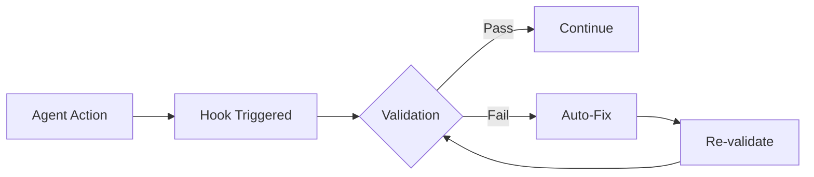

# Hook Integration with ACE-Flow

This document explains how hooks integrate with the ACE-Flow agent system and development workflow.

## Agent Integration

### How Agents Use Hooks

Agents automatically trigger and respond to hooks during their operations:

```typescript
// Example: Implementation agent using hooks
class ImplementationAgent {
  async implementFeature(spec: Specification) {
    // Pre-implementation validation
    await this.runHook('pre-implementation', { spec });
    
    // Generate code
    const code = await this.generateCode(spec);
    
    // Save triggers onFileSave hooks automatically
    await this.saveFile(code.path, code.content);
    
    // Post-implementation validation
    const validation = await this.runHook('post-implementation', {
      files: [code.path],
    });
    
    if (!validation.success) {
      await this.handleValidationErrors(validation.issues);
    }
  }
}
```

### Hook Feedback Loop

Hooks provide real-time feedback to agents:



## Workflow Integration

### 3-Phase Kiro Workflow

Hooks are active throughout all phases:

#### Phase 1: Requirements
- **Hook**: `validate-requirements`
- **Purpose**: Ensure EARS notation compliance
- **Auto-fix**: Format requirements properly

#### Phase 2: Design  
- **Hook**: `validate-architecture`
- **Purpose**: Check AWS service selection
- **Auto-fix**: Suggest optimal services

#### Phase 3: Implementation
- **Hooks**: Multiple validation and fix hooks
- **Purpose**: Ensure code quality and compliance
- **Auto-fix**: Update syntax, fix imports, etc.

## Development Experience

### Real-Time Feedback

When developers save files, hooks provide immediate feedback:

```bash
# Developer saves auth configuration
$ # Save amplify/auth/resource.ts

🔍 Running hooks...
✅ validate-typescript: Passed
⚠️  validate-amplify-syntax: 1 issue found
   Line 15: Auth.federatedSignIn is deprecated
   Auto-fix available: Use signInWithRedirect instead
🔧 Applying auto-fix...
✅ File updated successfully
```

### IDE Integration

Hooks can integrate with VS Code through extensions:

```json
// .vscode/settings.json
{
  "ace-flow.hooks.enabled": true,
  "ace-flow.hooks.showInlineMessages": true,
  "ace-flow.hooks.autoFixOnSave": true,
  "editor.formatOnSave": false // Let hooks handle formatting
}
```

## Hook Chain Example

Here's how multiple hooks work together:

```typescript
// File saved: components/RecipeForm.tsx

// Hook 1: validate-typescript
{
  "valid": true,
  "message": "TypeScript validation passed"
}

// Hook 2: validate-react  
{
  "valid": false,
  "issues": [{
    "line": 45,
    "message": "Missing key prop in list items"
  }]
}

// Hook 3: check-accessibility
{
  "valid": false,
  "issues": [{
    "line": 23,
    "message": "Image missing alt text"
  }]
}

// Hook 4: fix-imports (runs after validation)
{
  "changed": true,
  "message": "Organized imports and updated to current patterns"
}
```

## Custom Hook Development

### Creating Project-Specific Hooks

```typescript
// .ace-flow/hooks/custom/validate-business-rules.ts
import { HookContext, HookResult } from '../types';

export async function validateBusinessRules(
  context: HookContext
): Promise<HookResult> {
  const { filePath, content } = context;
  const issues = [];
  
  // Example: Ensure all prices have currency
  if (filePath.includes('/models/')) {
    const pricePattern = /price:\s*a\.float\(\)/g;
    if (pricePattern.test(content)) {
      issues.push({
        type: 'error',
        message: 'Price fields must include currency field',
        fix: 'Add currency: a.string().required()',
      });
    }
  }
  
  return {
    valid: issues.length === 0,
    issues,
  };
}
```

### Registering Custom Hooks

```json
// .ace-flow/hooks/config.json
{
  "hooks": {
    "onFileSave": {
      "patterns": {
        "**/models/**/*.ts": ["validate-business-rules"]
      }
    }
  }
}
```

## Performance Monitoring

### Hook Metrics

Track hook performance and effectiveness:

```typescript
// .ace-flow/hooks/metrics.json
{
  "hooks": {
    "validate-amplify-syntax": {
      "runs": 1523,
      "failures": 234,
      "autoFixed": 189,
      "averageTime": "45ms",
      "lastRun": "2024-01-20T10:30:00Z"
    },
    "fix-imports": {
      "runs": 892,
      "changes": 567,
      "averageTime": "23ms",
      "lastRun": "2024-01-20T10:29:00Z"
    }
  },
  "summary": {
    "totalRuns": 2415,
    "totalIssuesFound": 234,
    "totalAutoFixed": 189,
    "successRate": "80.8%"
  }
}
```

## Debugging Hooks

### Enable Debug Mode

```bash
# Run with debug logging
ACE_HOOKS_DEBUG=true npm run dev

# Debug specific hook
ACE_HOOKS_DEBUG=validate-amplify-syntax npm run dev
```

### Hook Logs

```
[HOOK] validate-amplify-syntax starting for file: amplify/auth/resource.ts
[HOOK] Found 2 deprecated patterns
[HOOK] Auto-fix available, applying...
[HOOK] File updated successfully
[HOOK] validate-amplify-syntax completed in 42ms
```

## Best Practices

### For Hook Developers

1. **Fast Execution**: Keep hooks under 100ms
2. **Clear Messages**: Provide actionable feedback
3. **Safe Fixes**: Never break working code
4. **Incremental**: Validate only what changed
5. **Cacheable**: Cache expensive operations

### For ACE-Flow Users

1. **Trust the System**: Let hooks fix issues automatically
2. **Review Changes**: Understand what hooks changed
3. **Customize Carefully**: Add project-specific rules
4. **Monitor Performance**: Track hook metrics
5. **Report Issues**: Help improve hook accuracy

## Troubleshooting

### Common Issues

#### Hooks Not Running
```bash
# Check if hooks are enabled
cat .ace-flow/hooks/config.json | grep enabled

# Check hook scripts exist
ls -la .ace-flow/hooks/scripts/

# Run hook manually
node .ace-flow/hooks/scripts/validate-amplify-syntax.js file.ts
```

#### Auto-Fix Not Working
```bash
# Check auto-fix setting
cat .ace-flow/hooks/config.json | grep autoFix

# Check file permissions
ls -la amplify/

# Run with verbose logging
ACE_HOOKS_VERBOSE=true npm run dev
```

#### Performance Issues
```bash
# Disable parallel execution
export ACE_HOOKS_PARALLEL=false

# Increase timeout
export ACE_HOOKS_TIMEOUT=10000

# Profile specific hook
export ACE_HOOKS_PROFILE=validate-amplify-syntax
```

---

Hooks are the nervous system of ACE-Flow, providing continuous feedback and automatic corrections throughout the development process. They ensure code quality without interrupting developer flow.