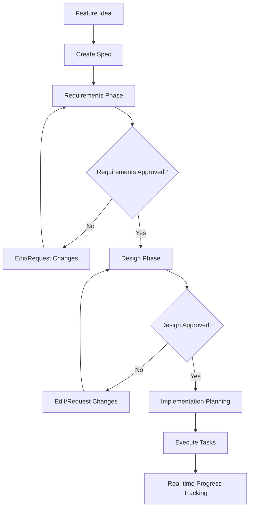

# Kiro Specifications Workflow (Detailed Analysis)

## 🎯 **Core Concept: Specification-Driven Development**

Kiro transforms vague feature ideas into structured, trackable specifications through a three-phase workflow that bridges product requirements and technical implementation.

## 📋 **Three-Phase Workflow Detail**

### **Phase 1: Requirements Analysis**
**File**: `requirements.md`
**Format**: EARS Notation (Easy Approach to Requirements Syntax)

```markdown
# Requirements for [Feature Name]

## User Stories

### Story 1: [User Action]
**As a** [user type]
**I want** [functionality]
**So that** [benefit/value]

**Acceptance Criteria:**
WHEN [specific condition/event occurs]
THE SYSTEM SHALL [expected behavior/response]

WHEN [another condition]
THE SYSTEM SHALL [another behavior]

### Story 2: [Next User Action]
[... repeat pattern ...]
```

**Benefits of EARS Notation:**
- **Clarity**: Unambiguous, structured requirements
- **Testability**: Direct translation to test cases
- **Traceability**: Individual requirements tracked through implementation
- **Completeness**: Forces thinking through all conditions

### **Phase 2: Technical Design**
**File**: `design.md`
**Content**: Technical architecture and implementation planning

```markdown
# Design for [Feature Name]

## Architecture Overview
- System components and their responsibilities
- Data flow between components
- Integration points with existing systems

## Sequence Diagrams
[Visual representations of process flows]

## Data Models
- Database schema changes
- API request/response structures
- State management patterns

## Technical Considerations
- Performance implications
- Security requirements
- Error handling strategies
- Testing approach

## Implementation Strategy
- Development phases
- Risk mitigation
- Dependencies and blockers
```

### **Phase 3: Implementation Planning**
**File**: `tasks.md`
**Format**: Discrete, trackable tasks with status

```markdown
# Implementation Tasks for [Feature Name]

## Phase 1: Foundation
- [ ] Task 1: Set up database schema
  - **Description**: Create new tables for feature data
  - **Outcome**: Database ready for feature development
  - **Estimate**: 2 hours
  - **Dependencies**: None

- [x] Task 2: Create API endpoints
  - **Description**: Build REST endpoints for CRUD operations
  - **Outcome**: API routes available and tested
  - **Estimate**: 4 hours
  - **Dependencies**: Task 1

## Phase 2: Core Logic
- [ ] Task 3: Implement business logic
  - **Description**: Core feature functionality
  - **Outcome**: Feature works according to requirements
  - **Estimate**: 6 hours
  - **Dependencies**: Task 2

[... continues with all implementation tasks ...]
```

## 🔄 **Workflow Decision Points**



## 🛠️ **Kiro's User Interface Pattern**

1. **Spec Creation**: Click '+' in spec pane or choose "Spec" from chat
2. **Interactive Generation**: Describe project idea, Kiro generates three files
3. **Phase Progression**: Work through Requirements → Design → Implementation
4. **Real-time Updates**: Task status updates as work progresses
5. **Collaboration**: Product and engineering work from same specification

## 🎯 **Key Success Factors**

1. **Structured Format**: EARS notation ensures clear, testable requirements
2. **Logical Progression**: Each phase builds on the previous one
3. **Decision Gates**: Approval points prevent moving forward with incomplete work
4. **Trackable Tasks**: Implementation broken into discrete, measurable units
5. **Living Document**: Specs updated as implementation progresses

## 🚀 **ACE-Flow Adaptation Strategy**

### **Command Mapping**:
- **`/ace new`** → Create three-file spec structure
- **`/ace review`** → Check progress across all three phases
- **`/ace implement`** → Execute tasks.md with real-time tracking
- **`/ace-spec requirements`** → Focus on requirements phase
- **`/ace-spec design`** → Focus on design phase
- **`/ace-spec tasks`** → Focus on implementation planning

### **Agent Specialization**:
- **Requirements Agent** → EARS notation generation
- **Design Agent** → Technical architecture documentation
- **Implementation Agent** → Task breakdown and execution
- **Validation Agent** → Phase completion verification

### **File Structure**:
```
.ace-flow/specs/[feature-name]/
├── requirements.md    # EARS notation user stories
├── design.md         # Technical architecture
├── tasks.md          # Implementation plan
└── .ace-metadata.json # Tracking and status information
```

This structured approach ensures that ACE-Flow can provide the same level of specification-driven development that makes Kiro effective, while integrating with AWS Amplify Gen 2 patterns.