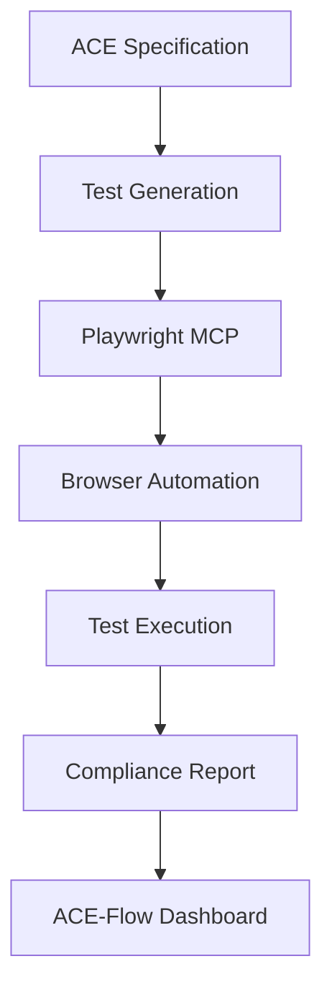

# 🎭 Playwright MCP Integration for ACE-Flow E2E Testing

## Overview

This document outlines how to leverage Playwright MCP (Model Context Protocol) for comprehensive end-to-end testing in ACE-Flow projects, ensuring specification compliance and AWS Amplify Gen 2 best practices.

## Architecture

### Testing Flow


## Available Playwright MCP Functions

### Core Browser Control
- `mcp__playwright__browser_navigate` - Navigate to URLs
- `mcp__playwright__browser_snapshot` - Capture accessibility snapshots
- `mcp__playwright__browser_take_screenshot` - Visual validation
- `mcp__playwright__browser_close` - Clean up sessions

### User Interactions
- `mcp__playwright__browser_click` - Click elements
- `mcp__playwright__browser_type` - Type text with optional submission
- `mcp__playwright__browser_select_option` - Dropdown interactions
- `mcp__playwright__browser_drag` - Drag and drop operations
- `mcp__playwright__browser_hover` - Hover interactions

### Advanced Testing
- `mcp__playwright__browser_evaluate` - Execute JavaScript
- `mcp__playwright__browser_wait_for` - Wait for conditions
- `mcp__playwright__browser_console_messages` - Monitor console
- `mcp__playwright__browser_network_requests` - Track API calls

## E2E Test Examples for ACE-Flow

### Example 1: AWS Amplify Authentication Flow

```typescript
// ace-flow-tests/auth/signup-flow.e2e.ts
/**
 * User Story: US-001 - User Registration
 * Acceptance Criteria: AC-001-01 - User can register with email
 * Specification Source: ace-genesis/specs/auth-requirements.json
 */

export async function testUserSignupFlow() {
  // Navigate to the application
  await mcp__playwright__browser_navigate({ 
    url: "http://localhost:3000" 
  });
  
  // Take initial snapshot for accessibility baseline
  const initialSnapshot = await mcp__playwright__browser_snapshot();
  
  // Click sign up button
  await mcp__playwright__browser_click({
    element: "Sign Up button",
    ref: "button[data-testid='signup-button']"
  });
  
  // Fill registration form
  await mcp__playwright__browser_type({
    element: "Email input field",
    ref: "input[name='email']",
    text: "test@example.com"
  });
  
  await mcp__playwright__browser_type({
    element: "Password input field", 
    ref: "input[name='password']",
    text: "SecurePassword123!",
    slowly: true // Test character-by-character input
  });
  
  // Monitor network for Amplify Auth API calls
  const networkRequests = await mcp__playwright__browser_network_requests();
  
  // Submit form
  await mcp__playwright__browser_click({
    element: "Create Account button",
    ref: "button[type='submit']"
  });
  
  // Wait for confirmation code screen
  await mcp__playwright__browser_wait_for({
    text: "Enter confirmation code"
  });
  
  // Verify Amplify Gen 2 auth pattern
  await mcp__playwright__browser_evaluate({
    function: "() => { return window.amplifyConfig?.Auth?.Cognito !== undefined }"
  });
  
  // Take final screenshot for visual regression
  await mcp__playwright__browser_take_screenshot({
    filename: "signup-confirmation-screen.png",
    fullPage: true
  });
}
```

### Example 2: Real-time Data Subscription Test

```typescript
// ace-flow-tests/realtime/subscription.e2e.ts
/**
 * User Story: US-012 - Real-time Updates
 * Acceptance Criteria: AC-012-02 - User sees live updates
 * Tests Amplify Gen 2 subscription patterns
 */

export async function testRealtimeSubscription() {
  // Setup: Open two browser tabs
  await mcp__playwright__browser_navigate({ 
    url: "http://localhost:3000/dashboard" 
  });
  
  // Tab 1: Monitor for updates
  const tab1Index = 0;
  
  // Open second tab
  await mcp__playwright__browser_tab_new({
    url: "http://localhost:3000/dashboard"
  });
  
  // Tab 2: Create new item
  await mcp__playwright__browser_tab_select({ index: 1 });
  
  await mcp__playwright__browser_click({
    element: "Add Item button",
    ref: "button[data-testid='add-item']"
  });
  
  await mcp__playwright__browser_type({
    element: "Item name input",
    ref: "input[name='itemName']", 
    text: "Real-time Test Item"
  });
  
  // Monitor console for subscription messages
  const consoleMessages = await mcp__playwright__browser_console_messages();
  
  await mcp__playwright__browser_click({
    element: "Save button",
    ref: "button[data-testid='save-item']"
  });
  
  // Switch back to first tab
  await mcp__playwright__browser_tab_select({ index: tab1Index });
  
  // Wait for real-time update
  await mcp__playwright__browser_wait_for({
    text: "Real-time Test Item",
    time: 5 // 5 second timeout
  });
  
  // Verify subscription worked
  await mcp__playwright__browser_evaluate({
    function: `() => {
      const items = document.querySelectorAll('[data-testid="item"]');
      return Array.from(items).some(item => 
        item.textContent.includes('Real-time Test Item')
      );
    }`
  });
}
```

### Example 3: Accessibility Compliance Test

```typescript
// ace-flow-tests/a11y/wcag-compliance.e2e.ts
/**
 * Accessibility compliance testing
 * Ensures WCAG 2.1 AA standards
 */

export async function testAccessibilityCompliance() {
  const pagesToTest = [
    { url: "/", name: "Home" },
    { url: "/dashboard", name: "Dashboard" },
    { url: "/profile", name: "Profile" }
  ];
  
  const results = [];
  
  for (const page of pagesToTest) {
    await mcp__playwright__browser_navigate({ url: `http://localhost:3000${page.url}` });
    
    // Capture accessibility tree
    const a11ySnapshot = await mcp__playwright__browser_snapshot();
    
    // Test keyboard navigation
    await mcp__playwright__browser_press_key({ key: "Tab" });
    await mcp__playwright__browser_press_key({ key: "Tab" });
    
    // Check focus indicators
    const focusVisible = await mcp__playwright__browser_evaluate({
      function: `() => {
        const focused = document.activeElement;
        const styles = window.getComputedStyle(focused);
        return styles.outline !== 'none' || styles.boxShadow !== 'none';
      }`
    });
    
    // Test screen reader landmarks
    const landmarks = await mcp__playwright__browser_evaluate({
      function: `() => {
        return {
          main: document.querySelector('main') !== null,
          nav: document.querySelector('nav') !== null,
          headings: document.querySelectorAll('h1, h2, h3').length
        };
      }`
    });
    
    results.push({
      page: page.name,
      snapshot: a11ySnapshot,
      keyboardNav: focusVisible,
      landmarks
    });
  }
  
  return results;
}
```

### Example 4: File Upload Test

```typescript
// ace-flow-tests/media/file-upload.e2e.ts
/**
 * Tests AWS Amplify Storage integration
 * Validates file upload with Gen 2 patterns
 */

export async function testFileUpload() {
  await mcp__playwright__browser_navigate({ 
    url: "http://localhost:3000/media" 
  });
  
  // Prepare test file
  const testFilePath = "/tmp/test-image.jpg";
  
  // Trigger file upload
  await mcp__playwright__browser_file_upload({
    paths: [testFilePath]
  });
  
  // Monitor network for S3 upload
  const networkRequests = await mcp__playwright__browser_network_requests();
  const s3Upload = networkRequests.find(req => 
    req.url.includes('s3.amazonaws.com')
  );
  
  // Wait for upload completion
  await mcp__playwright__browser_wait_for({
    text: "Upload complete"
  });
  
  // Verify Amplify Storage pattern
  await mcp__playwright__browser_evaluate({
    function: `() => {
      // Check for Gen 2 storage pattern
      return typeof window.amplifyStorage?.uploadData === 'function';
    }`
  });
}
```

## Integration with ACE-Flow Commands

### Test Generation Command
```bash
# Generate E2E tests from specifications
/ace-test-gen --spec="US-001" --type="e2e" --tool="playwright-mcp"
```

### Test Execution Command
```bash
# Run E2E tests with Playwright MCP
/ace-test-run --suite="e2e" --reporter="spec-compliance"
```

### Continuous Testing Hook
```json
{
  "PostImplement": [
    {
      "type": "command",
      "command": "ace-test-run",
      "args": ["--suite=e2e", "--fail-fast"]
    }
  ]
}
```

## Best Practices

### 1. Specification Traceability
Always link tests to acceptance criteria:
```typescript
/**
 * @acceptance-criteria AC-001-01
 * @user-story US-001
 * @specification-version 1.2.0
 */
```

### 2. AWS Amplify Gen 2 Validation
Verify correct patterns in every test:
```typescript
// Always check for Gen 2 patterns
await mcp__playwright__browser_evaluate({
  function: `() => {
    // Verify Gen 2 client usage
    return window.amplifyClient?.models !== undefined;
  }`
});
```

### 3. Accessibility First
Include accessibility checks in all tests:
```typescript
// Capture snapshot for every major interaction
const snapshot = await mcp__playwright__browser_snapshot();
// Analyze snapshot for WCAG compliance
```

### 4. Real-time Testing
Test subscriptions and live updates:
```typescript
// Use multiple tabs for real-time scenarios
await mcp__playwright__browser_tab_new();
// Simulate concurrent users
```

### 5. Network Monitoring
Track API calls for compliance:
```typescript
const requests = await mcp__playwright__browser_network_requests();
// Verify only Gen 2 API patterns
```

## Reporting Integration

### Specification Compliance Report
```json
{
  "test_run": {
    "timestamp": "2025-01-28T10:00:00Z",
    "suite": "e2e-playwright-mcp",
    "results": {
      "total_tests": 40,
      "passed": 38,
      "failed": 2,
      "specification_coverage": {
        "acceptance_criteria_tested": 35,
        "total_acceptance_criteria": 40,
        "coverage_percentage": 87.5
      },
      "amplify_gen2_compliance": {
        "compliant_patterns": 38,
        "legacy_patterns_found": 0,
        "compliance_score": 100
      },
      "accessibility_compliance": {
        "wcag_aa_pass": 36,
        "wcag_aa_fail": 2,
        "compliance_score": 90
      }
    }
  }
}
```

## Troubleshooting

### Common Issues

1. **Browser Not Installed**
   ```typescript
   await mcp__playwright__browser_install();
   ```

2. **Timing Issues**
   ```typescript
   await mcp__playwright__browser_wait_for({ time: 5 });
   ```

3. **Element Not Found**
   ```typescript
   // Use snapshot to debug
   const snapshot = await mcp__playwright__browser_snapshot();
   console.log(snapshot);
   ```

## Future Enhancements

1. **AI-Powered Test Generation**
   - Auto-generate tests from acceptance criteria
   - Smart element selection using AI

2. **Visual Regression Testing**
   - Screenshot comparison between runs
   - Automatic visual diff reports

3. **Performance Testing**
   - Page load time tracking
   - Resource usage monitoring

4. **Cross-browser Testing**
   - Multiple browser support
   - Mobile device emulation

---

This integration enables comprehensive E2E testing that ensures ACE-Flow projects maintain specification compliance while leveraging modern AWS Amplify Gen 2 patterns.