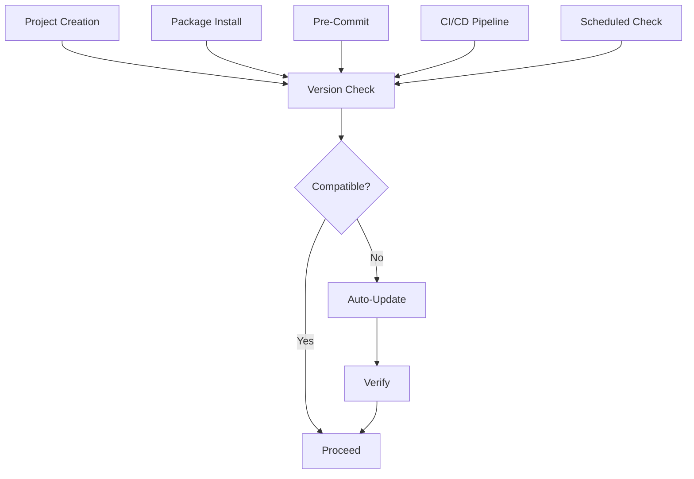

# 🔄 ACE-Flow Automatic Version Update Workflow

This document describes how ACE-Flow ensures projects always use the most Amplify Gen 2 compatible version of Next.js through automated workflows and smart hooks.

## Architecture Overview



## Implementation Strategy

### 1. Project Initialization Hook

```typescript
// ace-flow/hooks/project-init.ts
export async function onProjectInit(projectPath: string) {
  const checker = new AmplifyNextJsCompatibilityChecker(projectPath);
  const result = await checker.checkCompatibility();
  
  if (!result.isCompatible) {
    console.log('⚠️  Incompatible versions detected');
    console.log('🔄 Auto-updating to compatible versions...');
    
    await checker.updateToCompatibleVersions();
    console.log('✅ Updated to compatible versions');
  }
}
```

### 2. Package Manager Hooks

#### NPM Hook (`.npmrc`)
```ini
# Automatically check compatibility after install
oninstall = "npx ace-version-check --quiet"
```

#### Yarn Hook (`.yarnrc.yml`)
```yaml
afterInstall:
  - "yarn ace-version-check --quiet"
```

#### PNPM Hook (`.pnpmfile.cjs`)
```javascript
module.exports = {
  hooks: {
    afterAllResolved(lockfile, context) {
      // Check version compatibility
      require('./ace-flow/version-check').checkCompatibility();
      return lockfile;
    }
  }
};
```

### 3. Git Hooks Integration

#### Pre-Commit Hook
```bash
#!/bin/bash
# .husky/pre-commit

# Check version compatibility before every commit
npx ace-version-check --quiet || {
  echo "❌ Version compatibility issues detected"
  echo "Run 'npx ace-version-check --update' to fix"
  exit 1
}
```

#### Post-Merge Hook
```bash
#!/bin/bash
# .husky/post-merge

# Check for version changes after merge
if git diff HEAD~ HEAD --name-only | grep -q "package.json"; then
  echo "📦 Package.json changed, checking compatibility..."
  npx ace-version-check --update-if-needed
fi
```

### 4. CI/CD Integration

#### GitHub Actions
```yaml
name: Version Compatibility Check

on:
  push:
    paths:
      - 'package.json'
      - 'package-lock.json'
      - 'yarn.lock'
      - 'pnpm-lock.yaml'
  pull_request:
    paths:
      - 'package.json'
  schedule:
    - cron: '0 9 * * 1' # Weekly on Monday

jobs:
  version-check:
    runs-on: ubuntu-latest
    steps:
      - uses: actions/checkout@v4
      
      - name: Setup Node.js
        uses: actions/setup-node@v4
        with:
          node-version: '20'
          
      - name: Check Version Compatibility
        run: |
          npx ace-version-check --ci --fail-on-incompatible
          
      - name: Auto-Update PR
        if: failure() && github.event_name == 'schedule'
        run: |
          npx ace-version-check --update
          git config user.name "ACE-Flow Bot"
          git config user.email "bot@ace-flow.dev"
          git checkout -b update-versions-$(date +%Y%m%d)
          git add package.json package-lock.json
          git commit -m "chore: update to Amplify-compatible Next.js version"
          gh pr create --title "Update to compatible Next.js version" \
            --body "Auto-generated PR to update Next.js to a version compatible with AWS Amplify Gen 2"
```

### 5. ACE-Flow Command Integration

#### Enhanced ace-genesis
```typescript
// Modify ace-genesis to include version check
export async function aceGenesis(pattern: string) {
  // ... existing code ...
  
  // After project scaffold
  console.log('🔍 Checking version compatibility...');
  const compatible = await checkVersionCompatibility();
  
  if (!compatible) {
    console.log('📦 Installing compatible versions...');
    await installCompatibleVersions();
  }
  
  // Continue with genesis...
}
```

#### Enhanced ace-implement
```typescript
// Add pre-implementation check
export async function aceImplement(feature: string) {
  // Version gate
  const versionCheck = await checkVersionCompatibility();
  if (!versionCheck.isCompatible) {
    console.warn('⚠️  Version compatibility issues may affect implementation');
    console.log('Run ace-version-check --update to fix');
    
    // Optionally block
    if (process.env.ACE_STRICT_VERSIONS === 'true') {
      throw new Error('Version compatibility required');
    }
  }
  
  // Continue with implementation...
}
```

### 6. Smart Detection System

```typescript
// ace-flow/version-management/smart-detector.ts
export class VersionSmartDetector {
  private watchPatterns = [
    'amplify/**/*.ts',
    'app/**/page.tsx',
    'pages/**/*.tsx'
  ];
  
  async detectIncompatiblePatterns(): Promise<Issue[]> {
    const issues: Issue[] = [];
    
    // Check for Next.js 13 patterns with Amplify Gen 2
    if (await this.hasAppDirectory() && await this.hasAmplifyGen2()) {
      const nextVersion = await this.getNextJsVersion();
      if (semver.lt(nextVersion, '14.0.0')) {
        issues.push({
          severity: 'high',
          message: 'App Router requires Next.js 14+ with Amplify Gen 2',
          fix: 'ace-version-check --update'
        });
      }
    }
    
    // Check for deprecated patterns
    const deprecatedPatterns = await this.scanForDeprecatedPatterns();
    issues.push(...deprecatedPatterns);
    
    return issues;
  }
}
```

### 7. Monitoring Dashboard

```typescript
// ace-flow/version-management/dashboard.ts
export class VersionMonitoringDashboard {
  async generateReport(): Promise<DashboardReport> {
    const projects = await this.scanAllProjects();
    
    return {
      timestamp: new Date().toISOString(),
      summary: {
        totalProjects: projects.length,
        compatible: projects.filter(p => p.isCompatible).length,
        needsUpdate: projects.filter(p => !p.isCompatible).length
      },
      recommendations: this.generateRecommendations(projects),
      alerts: this.checkForSecurityAlerts(projects)
    };
  }
  
  async sendWeeklyReport() {
    const report = await this.generateReport();
    
    // Send to configured channels
    if (config.slack) {
      await this.sendToSlack(report);
    }
    if (config.email) {
      await this.sendEmail(report);
    }
  }
}
```

## Configuration Options

### ace-flow.config.json
```json
{
  "versionManagement": {
    "enabled": true,
    "strategy": "auto-update", // "auto-update" | "warn-only" | "strict"
    "checkFrequency": "commit", // "commit" | "daily" | "weekly"
    "compatibility": {
      "nextjs": {
        "strategy": "recommended", // "recommended" | "latest-compatible" | "pinned"
        "allowPrerelease": false,
        "customMatrix": null // Path to custom compatibility matrix
      },
      "amplify": {
        "minVersion": "6.8.0",
        "blockOnIncompatible": true
      }
    },
    "notifications": {
      "slack": {
        "enabled": true,
        "webhook": "${SLACK_WEBHOOK_URL}",
        "channel": "#ace-flow-versions"
      },
      "email": {
        "enabled": false,
        "recipients": ["team@example.com"]
      }
    },
    "autoUpdate": {
      "enabled": true,
      "createPR": true, // Create PR instead of direct update
      "runTests": true, // Run tests after update
      "requireApproval": false // Require manual approval
    }
  }
}
```

## Rollback Strategy

### Automatic Rollback on Failure
```typescript
export async function safeVersionUpdate() {
  const backup = await createBackup();
  
  try {
    await updateVersions();
    await runTests();
    
    // If tests pass, we're good
    console.log('✅ Version update successful');
  } catch (error) {
    console.error('❌ Version update failed, rolling back...');
    await restoreBackup(backup);
    throw error;
  }
}
```

### Manual Rollback Command
```bash
# Rollback to previous versions
ace-version-check --rollback

# Rollback to specific backup
ace-version-check --rollback --backup-id="2025-01-28-1000"
```

## Best Practices

### 1. Gradual Rollout
- Test updates in development first
- Use feature flags for version-specific features
- Monitor error rates after updates

### 2. Team Communication
- Notify team of version updates
- Document version decisions
- Share compatibility issues

### 3. Testing Strategy
- Run full test suite after updates
- Include version-specific tests
- Monitor performance metrics

### 4. Emergency Procedures
- Keep version backups
- Document rollback procedures
- Have manual override options

## Metrics and Monitoring

### Key Metrics to Track
1. **Compatibility Score**: % of projects with compatible versions
2. **Update Success Rate**: % of successful auto-updates
3. **Version Drift**: Time between releases and adoption
4. **Issue Resolution Time**: Time to fix version issues

### Alerting Rules
```yaml
alerts:
  - name: "High Version Incompatibility"
    condition: "compatibility_score < 80%"
    severity: "warning"
    
  - name: "Critical Security Update"
    condition: "security_patch_available"
    severity: "critical"
    
  - name: "Update Failure Rate High"
    condition: "update_failure_rate > 10%"
    severity: "error"
```

This comprehensive workflow ensures ACE-Flow projects always maintain optimal compatibility between Next.js and AWS Amplify Gen 2, reducing developer friction and preventing runtime issues.